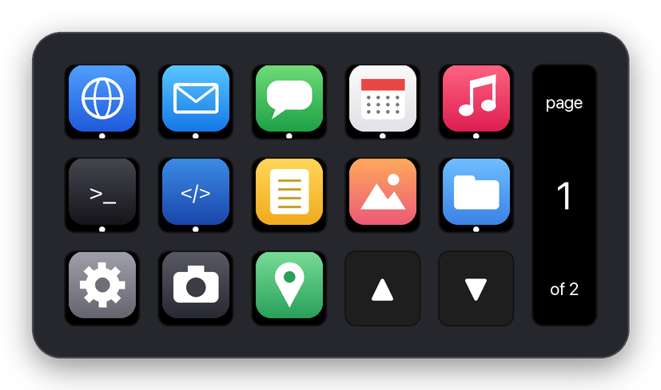
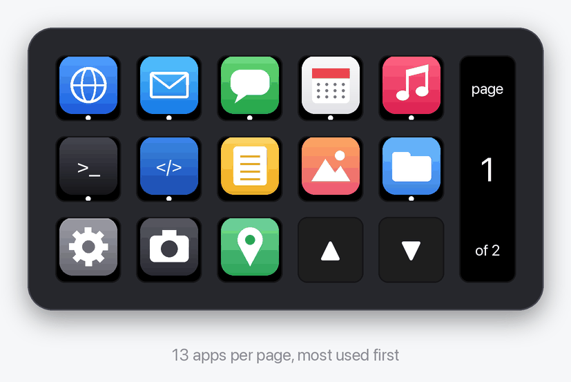

# dock-deck

Your Mac's Dock on a cheap stream dock. Every key is an app, sorted by how much you use it. Press a key to open the app, press it again to cycle through its windows, hold it to close a window or quit.

<p align="center">
  
</p>

## What it does

- **Shows your apps.** Everything in the Dock (pinned and running), plus every app you've used since dock-deck started, so a key doesn't disappear when you quit an app. A dot under an icon means the app is running.
- **Most-used first.** Apps are ranked by how often and how recently you use them. dock-deck re-sorts every few minutes, never while you're pressing keys.
- **Cycles windows.** Pressing the key of the app that is already in front brings up its next window, across every running instance of that app.
- **Closes and quits.** Hold a key for a moment: if the app has more than one window, its front window closes; with one window left, the app quits (it can still ask you to save). The key flashes red with "close" or "quit".
- **Pages.** 13 app keys per page. The two bottom-right keys page up and down; the display on the right shows where you are.
- **Stays up.** It reconnects when you unplug the deck, and it can start at login.

<p align="center">
  
</p>

## Hardware

Built for and tested on the **Mirabox HSV293S V3** (USB `6603:1014`, reports itself as "HOTSPOTEKUSB HID DEMO"). The same hardware is sold under several brand names, so check the USB IDs rather than the box:

```bash
ioreg -p IOUSB -l -w0 | grep -E '"idVendor"|"idProduct"|"USB Product Name"'
```

You want `idVendor = 26115` and `idProduct = 4116`.

The deck has 15 keys with a small screen in each, plus one display on the right that shows three images but has **no buttons**. Other Mirabox/Ajazz decks speak a close relative of the same protocol (see [Credits](#credits)), so porting means adjusting `streamdock.py`.

## Install

Needs macOS and Python 3.10 or newer.

```bash
uv tool install git+https://github.com/frankwiersma/dock-deck
```

or with pipx:

```bash
pipx install git+https://github.com/frankwiersma/dock-deck
```

Quit the vendor's own Stream Dock software first: only one program can drive the deck at a time.

## Use

```bash
dock-deck
```

To start it at login and keep it running in the background:

```bash
dock-deck install-agent
```

That writes `~/Library/LaunchAgents/io.github.dock-deck.plist` and starts it right away. Logs go to `~/Library/Logs/dock-deck.log`. `dock-deck uninstall-agent` removes it again.

### Window cycling needs Accessibility

Raising or closing a specific window takes macOS Accessibility permission. On first start, macOS asks for it; you can also grant it under **System Settings → Privacy & Security → Accessibility**. Without it, everything else works and a long press always quits the app.

When dock-deck runs as a login agent, the entry in that list is the Python interpreter dock-deck runs on (usually shown as **Python**). Keep in mind that the permission then applies to other background scripts run by that same interpreter too.

## How the ranking works

Each app gets a score:

```
score = log(1 + launches + minutes in front / 10) × recency
```

- **launches** and **last used** come from Spotlight (`kMDItemUseCount`, `kMDItemLastUsedDate`), so the ranking makes sense from day one.
- **Minutes in front** comes from dock-deck itself. Spotlight only counts launches, which makes apps you keep open all day look unused.
- **Recency** is 4 when the app was used in the last day, 2 in the last week, 1 in the last month and 0.5 before that.
- The log keeps one app with a huge launch count (browsers launch lots of helper processes) from taking over.

## Files

| What | Where |
|---|---|
| Time-in-front samples | `~/Library/Application Support/dock-deck/usage.json` |
| Icon cache | `~/Library/Caches/dock-deck/icons/` |
| Log (login agent) | `~/Library/Logs/dock-deck.log` |

Nothing leaves your Mac.

## Development

```bash
git clone https://github.com/frankwiersma/dock-deck
cd dock-deck
python3 -m venv .venv && .venv/bin/pip install -e .
.venv/bin/dock-deck
```

| Module | Does |
|---|---|
| `streamdock.py` | USB HID driver: key images, brightness, key events |
| `apps.py` | Which apps the Dock shows, and their icons |
| `usage.py` | Usage tracking and ranking |
| `windows.py` | Window cycling through the Accessibility API |
| `deck.py` | Key layout and the main loop |
| `cli.py` | Command line and the login agent |

The README images are drawn by `tools/render_docs.py`, with generic icons.

## Credits

The USB protocol and key layout come from [mirajazz](https://github.com/4ndv/mirajazz) and [opendeck-akp153](https://github.com/4ndv/opendeck-akp153) by 4ndv, which drive these decks from [OpenDeck](https://github.com/nekename/OpenDeck). dock-deck is an independent Python implementation.

## License

[MIT](LICENSE)
